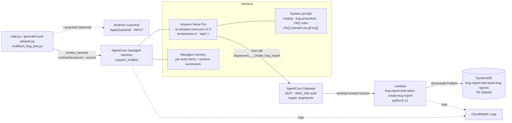
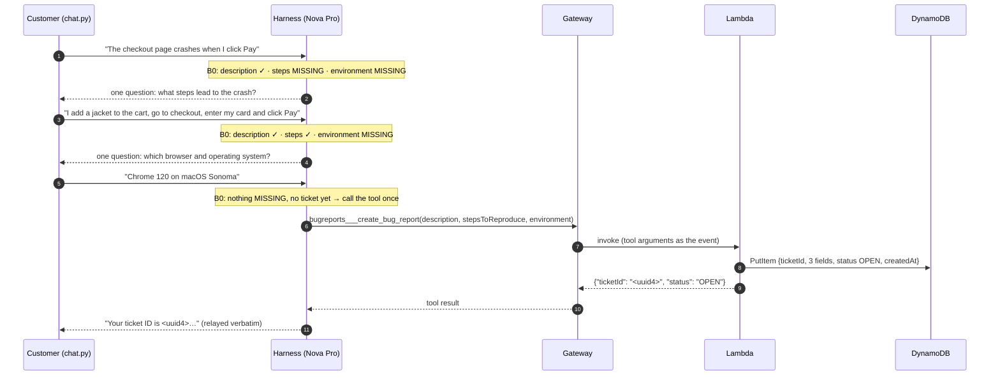
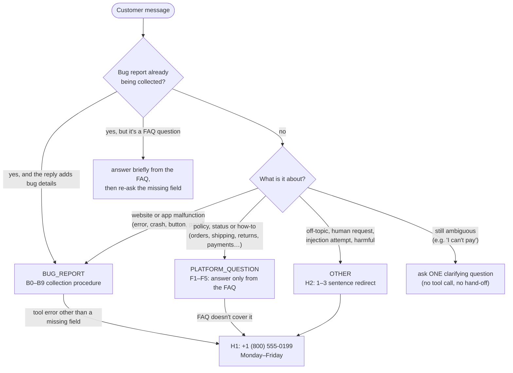
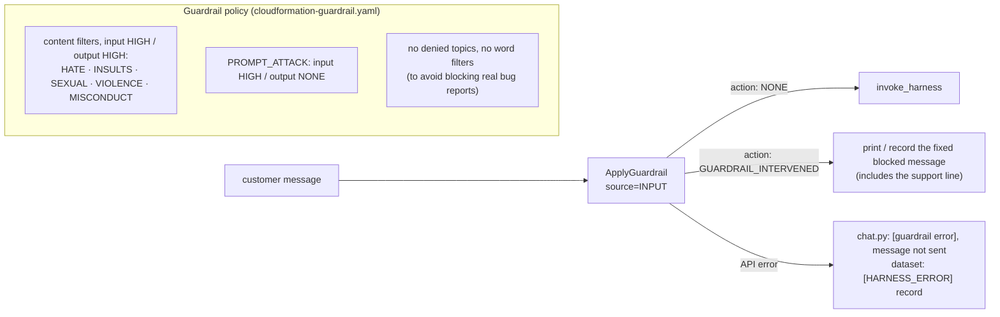
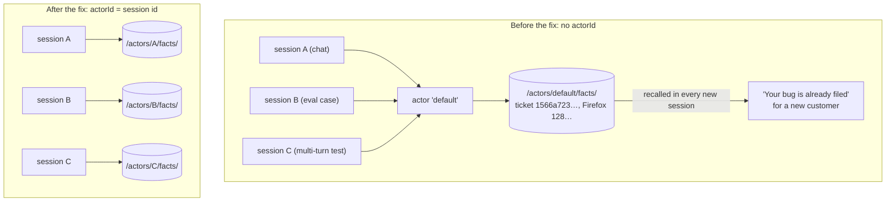
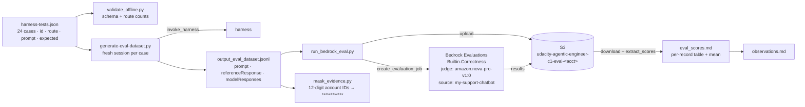
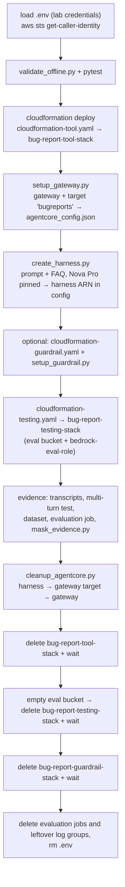
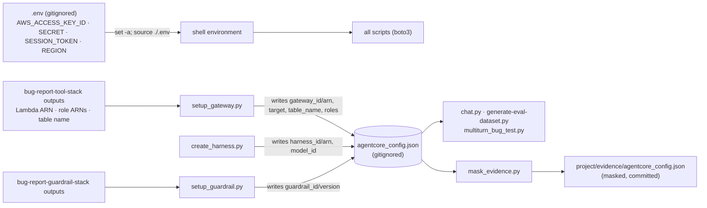

# Architecture — AgentCore Support Chatbot

Mermaid diagrams and notes for the single-prompt support chatbot. The diagrams are text, so they
diff cleanly and render on GitHub. For a plain-language walkthrough, start with
[`how-it-works.md`](how-it-works.md). The authoritative design is in
[`../specs/001-support-chatbot-routing/plan.md`](../specs/001-support-chatbot-routing/plan.md) and
the behavior contract in
[`../specs/001-support-chatbot-routing/contracts/system-prompt.md`](../specs/001-support-chatbot-routing/contracts/system-prompt.md).

---

## (a) System architecture

One AgentCore managed harness runs Amazon Nova Pro with the system prompt. There are no worker
agents and no separate classifier: routing, bug collection and FAQ grounding all happen inside that
one prompt. The only tool is `create_bug_report`, exposed to the model through an AgentCore Gateway
that invokes a Lambda function, which writes to DynamoDB. The guardrail is applied by the client
before the harness is called, because the harness API has no guardrail parameter.

The tool stack (DynamoDB, Lambda, three IAM roles) comes from CloudFormation. The gateway and the
harness are created by the course's boto3 scripts (`setup_gateway.py`, `create_harness.py`), which
write their IDs to `agentcore_config.json`.

---

## (b) Bug report flow (multi-turn)

The harness keeps the conversation for one `runtimeSessionId`, so details collected in earlier turns
are still available later. Before each reply, the model writes a checklist in `<thinking>` (rule B0).
It may call the tool only when no field is MISSING and no ticket has been filed yet in this
conversation.

If a field arrives empty, the Lambda returns `{"error": "missing required field(s): …"}` instead of
writing, and the model asks the customer for that field (rule B7). That check backs up the prompt
rule rather than replacing it.

---

## (c) Routing decision (inside the prompt)

Greedy decoding (temperature 0, topK 1) makes routing repeatable. The model picks exactly one route
per message, silently. The route names are internal labels and are never shown to the customer.

Two edge cases are worth calling out. A damaged physical item is a returns question (FAQ entry 16),
not a website bug (rule F4). A bare "refund" is answered with the refund timeline (FAQ 14), not the
return window (rule F5); that rule was added after evaluation run 1 scored it 0.

---

## (d) Guardrail path (optional, client-side)

With `--guardrail`, each customer message goes through `ApplyGuardrail` before the harness sees it.
`ApplyGuardrail` evaluates the text without invoking any model. If the guardrail check itself fails,
the client doesn't send the message (fail closed). The prompt's own injection rules (X1–X4) work
without the guardrail.

---

## (e) Memory and session isolation

The managed harness has AgentCore Memory with two long-term strategies: semantic facts stored under
`/actors/{actorId}/facts/` and session summaries under `/actors/{actorId}/summaries/{sessionId}/`.
Facts are keyed by actor, not by session. The course scripts originally sent no `actorId`, so every
session shared the `default` actor, and a ticket filed in one chat was recalled in later chats and
eval cases. The fix is to send `actorId = runtimeSessionId` on every invoke, which makes one
conversation equal one customer.

Memory extraction is eventually consistent, so a fact written in one turn may only be retrievable
seconds to minutes later. The 84 records already stored under `default` were deleted with
`BatchDeleteMemoryRecords`; the deletion took several seconds to show up in `ListMemoryRecords`.

---

## (f) Evaluation pipeline

Each of the 24 test cases runs in a fresh session (with its own actor), so cases can't influence
each other. The dataset uses Bedrock Evaluations' bring-your-own-inference format: the responses
were already produced by the harness, and the judge only scores them.

Results: run 1 averaged 0.917 (failures: the memory leak and the refund answer). Run 2 averaged
0.958, with the only 0 on `edge_cant_pay`. Details are in
[`../project/evidence/observations.md`](../project/evidence/observations.md).

---

## (g) Deployment and teardown order

Resources are created in dependency order and deleted in reverse. The harness execution role lives
in the tool stack, so the harness must be deleted before that stack.

Steps not covered by CloudFormation or `cleanup_agentcore.py` need explicit cleanup. These are the
evaluation jobs (they aren't stack resources) and the CloudWatch log groups that the harness runtime
and the Lambda create on first use. A finished evaluation job costs nothing to keep. While deployed,
the main costs are model calls (chat, eval generation, and the judge), DynamoDB and Lambda
on-demand usage, and log storage. None of the deployed resources has a large idle cost, but they
should still be torn down after the evidence is captured.

---

## (h) Configuration and credentials flow

`agentcore_config.json` is the state record: each setup script reads it and adds the IDs it
creates. The client scripts read the ARNs from it. Lab credentials come only from `.env`, which is
gitignored and loaded into the shell; no script reads it directly.

---

## AWS resources (reference)

| Resource | Name / pattern | Created by |
|---|---|---|
| DynamoDB table | `bug-report-tool-stack-bug-reports` (PK `ticketId`, on-demand) | `cloudformation-tool.yaml` |
| Lambda function | `bug-report-tool-stack-create-bug-report` (python3.12) | `cloudformation-tool.yaml` |
| IAM role (Lambda) | `bug-report-tool-stack-lambda-role`: `dynamodb:PutItem` on the table only | `cloudformation-tool.yaml` |
| IAM role (gateway) | `bug-report-tool-stack-gateway-role`: `lambda:InvokeFunction` on the function only | `cloudformation-tool.yaml` |
| IAM role (harness) | `bug-report-tool-stack-harness-role`: model invoke, logs, X-Ray, memory, gateway | `cloudformation-tool.yaml` |
| AgentCore Gateway | `bug-report-tool-stack-gateway` (MCP, AWS_IAM), target `bugreports` | `setup_gateway.py` |
| AgentCore harness | `support_chatbot` (Nova Pro pinned) plus its runtime and managed memory | `create_harness.py` |
| Bedrock Guardrail | `bug-report-guardrail-stack-guardrail` (numbered version) | `cloudformation-guardrail.yaml` (optional) |
| S3 bucket | `udacity-agentic-engineer-c1-eval-<acct>` | `cloudformation-testing.yaml` |
| IAM role (evaluation) | `bedrock-eval-role`: S3 access to the bucket, invoke Nova Pro | `cloudformation-testing.yaml` |
| Evaluation jobs | `support-chatbot-eval-run-<UTC timestamp>` | `run_bedrock_eval.py` |
| CloudWatch log groups | `/aws/lambda/bug-report-tool-stack-create-bug-report`, `/aws/bedrock-agentcore/runtimes/harness_support_chatbot-*` | created on first use |

**IAM scope.** The Lambda and gateway roles are scoped to single resource ARNs. The harness role
comes from the course template and is broader: it allows invoking any foundation model, uses `*` for
X-Ray and some logging actions, and includes Code Interpreter and AWS Marketplace permissions this
chatbot doesn't use. That's acceptable for a lab sandbox. For production, narrow it to the Nova Pro
inference profile, the specific gateway and memory ARNs, and the runtime's own log group, and drop
the unused actions.
