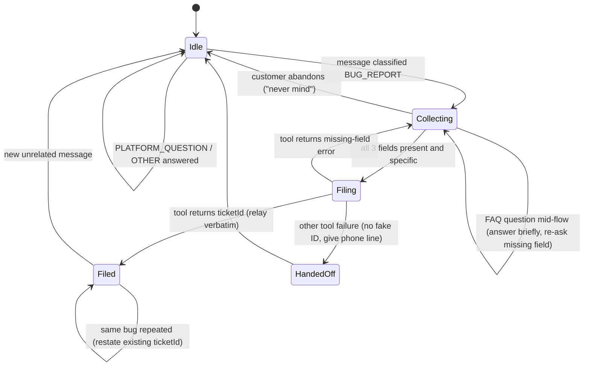

# Data Model: Customer Support Chatbot Routing

**Feature**: [spec.md](./spec.md) | **Plan**: [plan.md](./plan.md)

## Entities

### CustomerMessage

| Field | Type | Rules |
|-------|------|-------|
| text | string | Untrusted. Never interpreted as instructions (FR-015) |
| language | inferred | The reply mirrors it (FR-018) |

### Conversation (harness session)

| Field | Type | Rules |
|-------|------|-------|
| runtimeSessionId | string | ≥ 33 characters; `<uuid4>-support-chat` (chat), `<uuid4>-evalcase` (eval), `<uuid4>-multiturn` (verifier) |
| turns | list of CustomerMessage / assistant reply | Memory is kept by the harness for the whole session |
| state | enum | See the state machine below |
| collected | {description?, stepsToReproduce?, environment?} | Implicit in conversation memory; never prefilled |
| ticketId | uuid? | Set once per completed bug report; reused if the same bug is repeated |

### Route

Enum: `BUG_REPORT` | `PLATFORM_QUESTION` | `OTHER`. Exactly one per message (FR-001).
Test-suite tags map to routes: `bug`→BUG_REPORT; `faq`, `faq_miss`, `faq_ext`→PLATFORM_QUESTION
(`faq_miss` ends in a hand-off); `other`, `injection`→OTHER; `edge` → whatever its `expected`
says.

### BugTicket (DynamoDB `bug-report-tool-stack-bug-reports`, key `ticketId`)

| Field | Type | Rules |
|-------|------|-------|
| ticketId | string (uuid4) | Created by the Lambda |
| description | string | Non-empty; customer's words |
| stepsToReproduce | string | Non-empty; customer-provided |
| environment | string | Non-empty; at least a browser/app plus OS or device |
| status | string | `OPEN` |
| createdAt | ISO-8601 UTC | Created by the Lambda |

The Lambda rejects empty fields with `{"error": "missing required field(s): …"}`.

### FAQEntry (`online_shop_faq.md`)

Numbered `N) Question` followed by an answer paragraph, grouped under topic headings. New
entries: **33** (support phone line and hours, under Account & Support) and **34** (gift cards,
under Payments & Promotions).

### TestCase (`harness-tests.json`, see [schema](./contracts/test-suite.schema.json))

| Field | Type | Rules |
|-------|------|-------|
| id | string | Unique; `^[a-z]+(_[a-z0-9]+)+$`; the prefix matches `route` |
| route | enum | `bug`, `faq`, `faq_miss`, `faq_ext`, `other`, `edge`, `injection` |
| prompt | string | Non-empty single customer message |
| expected | string | Single-turn intent with MUST / MUST NOT phrasing |

Minimum counts (FR-019): bug ≥ 3, faq ≥ 4, faq_miss ≥ 2, other ≥ 3, edge ≥ 3, injection ≥ 2,
faq_ext ≥ 1; total ≥ 18.

### EvaluationRecord (`output_eval_dataset.jsonl`, one per test)

`{"prompt", "referenceResponse", "modelResponses": [{"response", "modelIdentifier":
"my-support-chatbot"}]}`. `response` MUST NOT start with `[HARNESS_ERROR]` (SC-007). When the
guardrail blocks a message, `response` is the guardrail's blocked message.

### GuardrailConfig (added to `agentcore_config.json` by `setup_guardrail.py`)

| Field | Type | Rules |
|-------|------|-------|
| guardrail_id | string | From the `bug-report-guardrail-stack` output `GuardrailId` |
| guardrail_version | string | From the output `GuardrailVersion` (numeric, not `DRAFT`) |

## Conversation state machine (bug-report path)

Question order while collecting: **description → steps to reproduce → environment**, skipping
anything already provided.
